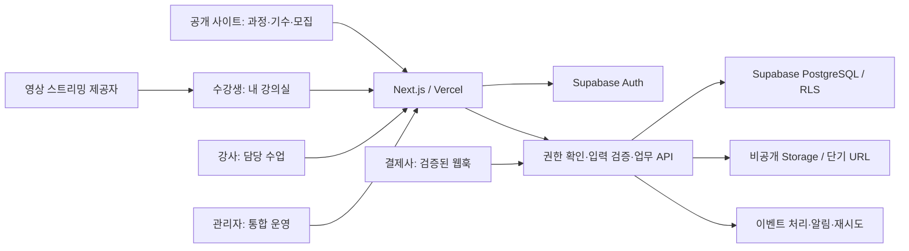
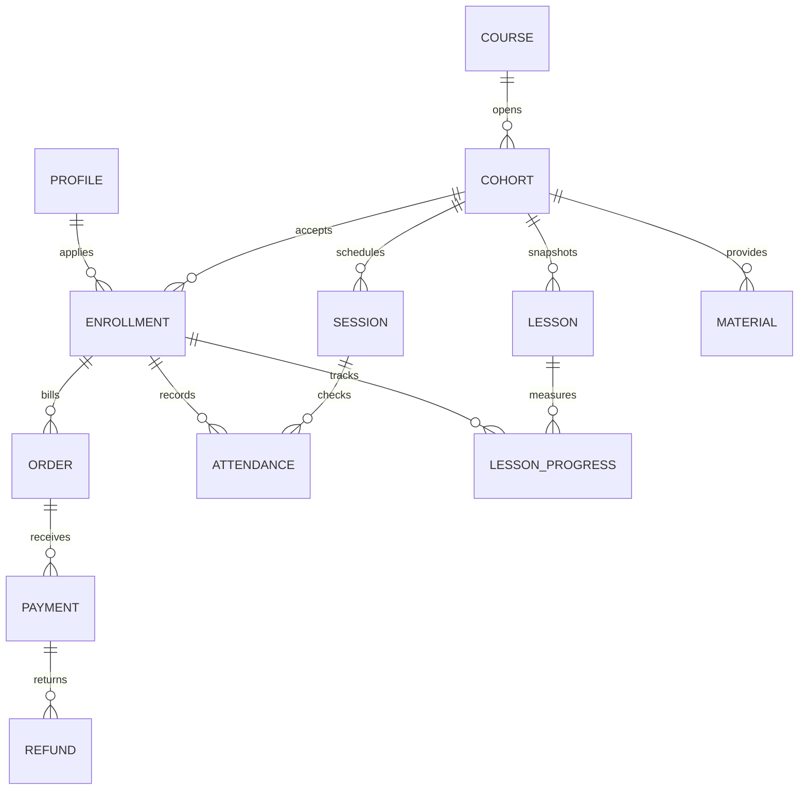

# 네오앤피터 통합 LMS 설계

작성일: 2026-10-19 · 상태: 회원·학사·소셜 로그인 및 수강신청·출결·진도 Supabase 전환 운영 배포 완료

수강신청·출결·진도의 추가 전환과 통합 관리 화면은 [학습 운영 전환 기록](./lms-learning-migration.md)을 따른다.

현재 구현·이전·검증·배포 기록은 [Supabase 적용 기록](./supabase-setup.md)을 기준으로 확인한다. 기존 회원 7명을 보존 이전하고 지정 계정에 관리자 권한을 부여했다. 사용자 승인 후 Supabase 서버 키를 Vercel Production에만 저장하고 https://aiedu1.vercel.app 에 배포했다. 카카오 실로그인과 일반 회원 관리자 접근 차단도 확인했다.

## 1. 목표와 설계 전제

이 사이트를 모집부터 수강·평가·수료·정산까지 운영하는 LMS로 확장한다. 관리자는 한 수강생의 신청, 결제, 강의, 출결, 과제, 상담, 환불 이력을 한 화면에서 조회한다. 강사는 담당 기수를 관리하고 수강생은 내 강의실에서 학습한다.

초기에는 네오앤피터 단일 운영기관을 기준으로 한다. 오프라인 특강, 실시간 온라인, VOD, 혼합 수업을 같은 과정·기수 구조로 지원한다. 기업 단체 교육은 회사·담당자·단체 주문 확장 대상으로 두며 여러 독립 학원이 서비스를 공유하는 멀티테넌트 SaaS는 별도 격리 설계 후 추가한다.

실제 회원 로그인 방식은 **카카오톡과 구글** 두 가지다. 기본 로그인 UI와 카카오 PKCE callback을 구현했으며, 기존 구글 회원은 Firebase UID를 보존한다. 실제 Kakao 공급자 설정 상태와 승인 범위는 [소셜 로그인 연결](./social-login-setup.md)에 기록한다. 로컬 실습 프로필은 인증된 LMS 회원으로 간주하지 않는다.

이 문서는 전체 설계다. 이번 단계에서는 **연결·세션 코드, 회원·역할·과정·기수 관리 API와 화면, 보존 이전, 17개 테이블, 관리 명령 함수, 권한 검증**을 구현했다. 사용자 지정 프로젝트 `ztfrqwpuypxbcimefcgw`에 두 마이그레이션을 적용하고 실제 Google 로그인과 Supabase 관리자 화면 연결을 로컬 프로덕션 빌드에서 확인했다. 회원·학사 관리와 카카오·구글 로그인은 운영 배포했으며 수강신청·출결·진도는 추가 Supabase 전환했으며 결제·평가·수료증·Storage 통합은 후속 작업이다.

## 2. 현행 구조와 전환 이유

| 영역 | 확인한 현행 구현 | 목표 |
|---|---|---|
| 배포 | `.vercel/project.json`의 `aiedu1` 연결 설정 | Next.js + Vercel 유지. aiedu1.vercel.app 배포, 서버 키 Production 전용 |
| 로그인 | Firebase Google Auth, 로컬 실습 프로필 | Supabase Auth 기반 실제 사용자 세션. 실습 프로필은 유료 수강 권한을 갖지 않음 |
| 교육 운영 | `aieduPlatforms/main`의 Firestore 하위 컬렉션 | 과정·기수·수강·차시·출결을 관계형 테이블로 분리 |
| 신청·정산 | Firestore 신청과 `settlement-store`의 브라우저 데이터가 분리 | 공통 수강 ID와 주문 ID로 통합 |
| 통장 대장 | `ledger-store`의 localStorage | 서버 원장 및 결제 대사 |
| 교안 | Firebase Storage의 토큰 다운로드 URL | 비공개 Storage 및 수강권 검증 후 단기 다운로드 |
| 갱신 | `/api/platform` 전체 데이터 5초 폴링 | 용도별 페이지 조회, 검색·페이지네이션, 필요한 부분만 갱신 |
| 홍보 | 인증된 Google 사용자에게 편집 허용 | 운영 담당자 권한으로 제한 |

현재 Firebase 프로젝트 `gahoseokho`는 다른 기능에서도 사용한다. 이전 범위는 이 사이트의 교육 운영 데이터와 명시적으로 확인한 자료로 제한한다. Firebase 프로젝트 전체나 다른 앱의 컬렉션을 이전·삭제하지 않는다.

## 3. 서비스 구성

일반 사용자 조회에는 사용자 세션과 RLS를 적용한다. 상태 변경은 서버 업무 API에서 수행한다. Secret key를 사용하는 경로는 반드시 인증·역할·소유권을 먼저 확인하며, RLS 우회 권한을 사용자 권한으로 간주하지 않는다. 결제 웹훅은 사용자 세션 대신 결제사 서명과 서버 조회 결과를 검증한다.

VOD는 영상 인코딩, 스트리밍, 재생 권한이 필요하다. Supabase Storage만으로 영상 LMS를 완성한 것으로 보지 않는다. 영상 제공자 선택은 VOD 비중·보호 수준·트래픽을 확인한 뒤 결정한다.

## 4. 화면과 업무 범위

| 사용자 | 화면 | 주요 작업 |
|---|---|---|
| 방문자 | 홈, 과정 목록, 과정·기수 상세 | 검색, 일정·가격·정원 확인, 신청 시작 |
| 수강생 | 내 강의실 | 승인된 기수, 다음 수업, 진도, 학습 만료일 |
| 수강생 | 수업 상세 | 영상·라이브·교안, 출결, 공지, 과제·퀴즈 |
| 수강생 | 내 결제·수료 | 주문·환불 이력, 증빙 요청, 수료증 |
| 강사 | 담당 기수 | 수강생 명단, 출결, 교안, 공지, 과제 채점 |
| 관리자 | 운영 대시보드 | 신청 대기, 미수금, 오늘 수업, 채점 대기, 수료 대상, 정산 대기 |
| 관리자 | 회원 상세 | 기본 정보, 모든 기수·주문·수강·상담·수료 이력을 탭과 타임라인으로 표시 |
| 관리자 | 과정·기수 | 공통 과정 정보, 기수별 일정·가격·정원·강사·수료 기준 |
| 관리자 | 수강·학습 | 신청 승인·대기·반려, 수강권, 출결, 진도, 평가, 수료 |
| 회계 담당 | 수납·환불·정산 | 주문, 검증된 입금·결제, 부분 환불, 대사, 강사 정산 |
| 운영 담당 | 소통·콘텐츠 | 공지, 상담, 알림, 후기 검수, 배너·홍보 |
| 관리자 | 설정·감사 | 역할 부여, 결제·알림 설정, 변경 이력 |

학습(LMS)과 수납·강사 정산(운영 ERP)은 공통 식별자를 공유한다. 관리자 화면은 업무를 연결하고 각 화면에서 같은 숫자를 다시 입력하지 않게 한다. 통장 입금내역은 수강료 결제와 대사하며 입금액을 매출에 중복 합산하지 않는다.

## 5. 데이터 모델

### 기반 마이그레이션에 포함한 16개 테이블

모든 테이블은 기존 테이블과 구별되는 `lms_` 접두사를 사용한다.

| 테이블 | 역할·제약 |
|---|---|
| `lms_schema_versions` | 연결 검사에 사용하는 버전 정보만 공개 |
| `lms_profiles` | 내부 회원 UUID, Supabase Auth UUID, 기존 Firebase UID를 분리. 미가입 신청자도 회원 레코드 보존 |
| `lms_staff_members` | 관리자·운영·회계 권한. 본인 프로필 수정으로 승격 불가 |
| `lms_courses` | 재사용하는 과정 소개·분류·공개 여부 |
| `lms_cohorts` | 실제 개강 단위. 일정·가격·정원·운영 방식·수료 기준 |
| `lms_cohort_instructors` | 한 기수의 복수 담당 강사 |
| `lms_lessons` | 기수별 커리큘럼 스냅샷. 공개해도 되는 제목·순서만 저장 |
| `lms_enrollments` | 회원과 기수 사이 수강권. 기수·회원 중복 방지, 접근 만료일 |
| `lms_sessions` | 실제 회차별 수업 일정. 비공개 라이브 입장 URL은 저장하지 않음 |
| `lms_attendance` | 회차별 출결. 다른 기수 수업과 결합할 수 없도록 복합 FK |
| `lms_lesson_progress` | 차시별 진행. 다른 기수 차시와 결합 방지, 진행률 0~100 |
| `lms_materials` | 비공개 객체 경로와 공개 시각. 영구 공개 다운로드 URL 저장 금지 |
| `lms_orders` | 주문별 실제 청구액, 상태, 중복 요청 방지 키 |
| `lms_payments` | 확인된 입금·결제 사실. 결제사 거래번호 중복 방지 |
| `lms_refunds` | 부분 환불을 포함한 환불 요청과 처리 상태. 중복 요청 방지 키 |
| `lms_audit_events` | 행위자·대상·요청 식별자·시각. 사용자 직접 변경 불가 |

금액은 원 단위 정수로 저장한다. 가격표 변경이 과거 주문 금액에 영향을 주지 않도록 주문 시점 금액을 보존한다. API에서 JSON을 반환할 때 금액의 안전한 정수 범위도 검증한다.

### 후속 마이그레이션으로 추가할 영역

| 영역 | 추가 엔티티 | 필요한 규칙 |
|---|---|---|
| 평가 | 과제, 제출물, 채점, 퀴즈, 응시, 답안 | 제출 버전, 마감·재제출, 점수 공개, 강사 범위 |
| 수료 | 수료 판정, 수료증, 취소 이력 | 수료 기준 버전, 중복 발급 방지, 검증 링크에 개인정보 최소화 |
| 교안·영상 | 콘텐츠 버전, 영상 자산, 재생 세션 | 서명 URL, 공개 시각, 서버에서 인정하는 진도 기준 |
| 상담·알림 | 상담 기록, 공지, 알림 발송 큐, 발송 결과 | 수신 동의, 대상 기수, 중복 방지, 실패 재시도 |
| 회계 | 통장 거래, 결제 대사, 정산 규칙·명세·지급 | 중복 입금 매칭 방지, 확정 명세 불변, 환불 조정분 반영 |
| 단체 교육 | 기업, 기업 담당자, 단체 주문·수강 배정 | 기업별 명단 접근 범위, 일괄 청구·개별 수강권 분리 |
| 사이트 운영 | 배너, 홍보 기록, 후기 | 작성·승인 권한, 게시 기간, 본인 수강 검증 |
| 이전 추적 | legacy ID 매핑, 이전 실행·오류 기록 | 재실행 가능한 upsert, 원본과 건수·합계 비교 |

기반 스키마만으로 과제·수료증·회계 원장이 구현됐다고 간주하지 않는다. `completion_policy` JSON은 기준 저장 자리이며 아직 수료 판정 로직을 실행하지 않는다.

## 6. 상태와 트랜잭션 규칙

수강, 주문, 결제, 환불, 정산 상태를 각각 관리한다. 기존의 `환불` 수강 상태 하나로 모든 사실을 표현하지 않는다.

- 기수: 초안 → 모집 → 모집 마감 → 진행 → 종료. 취소는 별도 상태.
- 수강: 신청 → 대기/승인/반려. 승인 후 취소·수강권 회수·수료를 구별한다. 같은 기수 재신청은 기존 수강권과 이력에 연결한다.
- 주문: 결제 대기 → 결제 완료 → 부분 환불/전액 환불. 미결제 주문 취소는 별도 처리한다.
- 결제: 검증된 거래만 기록한다. 브라우저의 결제 성공 화면만으로 수강권을 부여하지 않는다.
- 환불: 요청 → 처리 중 → 성공/실패. 누적 성공·처리 중 환불액이 잔여 결제액을 넘지 않도록 잠근다.
- 수료: 기수에 고정된 출결·필수 진도·평가 조건을 서버에서 판정하고 판정 근거를 보존한다.

다음 명령 API는 후속 구현에서 DB 트랜잭션 또는 제한된 RPC로 원자적으로 처리한다.

1. 신청·승인: 기수 행 잠금 → 모집 기간·정원·중복 검증 → 수강권·주문 기록 → 감사 이벤트.
2. 결제 확인: 서명 및 결제사 조회 → 거래번호·주문·금액 검증 → 결제 기록 → 주문·수강권 갱신. 무료 수강은 결제 거래를 가짜로 만들지 않고 승인 근거를 남긴다.
3. 환불: 결제 행 잠금 → 잔액 확인·요청 ID 보존 → 결제사 처리 → 결과 멱등 반영 → 필요 시 수강권 회수. 외부 호출 중 DB 잠금을 유지하지 않으며 실패 후 대사 작업으로 복구한다.
4. 출결·진도·채점: 담당자 또는 본인 권한 확인 → 기수 일치 확인 → 변경 사실과 감사 이벤트 기록.
5. 수료·정산: 기준 버전과 계산 근거를 고정 → 고유 키로 중복 확정 방지 → 후속 알림 큐.

지금 기반 테이블은 상태의 허용값, FK, 금액 범위와 중복 키를 검증한다. **상태 전이, 정원 경쟁, 과도한 환불 방지는 업무 API와 트랜잭션 구현 전까지 보장하지 않는다.** 이를 위해 현재 모든 클라이언트 쓰기 권한을 닫았다.

## 7. 권한·자료 접근

| 역할 | 조회 범위 | 변경 방식 |
|---|---|---|
| 비로그인 | 공개 과정·기수·커리큘럼 제목, DB 버전 | 없음 |
| 수강생 | 본인 프로필·수강·결제·출결·진도, 유효 수강권의 공개된 자료 | 인증된 업무 API |
| 담당 강사 | 담당 기수·수강 목록·출결·진도·교안 | 담당자 검증 API. 결제·환불 원문 조회 불가 |
| 운영 담당 | 회원·과정·수강·학습 운영 | 역할 검증 API. 결제 원문은 회계 권한 필요 |
| 회계 담당 | 회원·수강 식별 및 주문·결제·환불 | 검증된 수납·환불·정산 API. 교안 접근 권한 없음 |
| 관리자 | 전체 운영 데이터·감사 기록 | 별도 권한 검증. 관리자 브라우저도 DB 직접 쓰기 불가 |

강사에게 개인정보 전체 프로필을 공개하지 않는다. 명단의 표시 이름 등 필요한 항목은 후속 서버 DTO로 제공한다. 로그인 사용자가 자신의 역할을 프로필 metadata로 바꿔 권한을 얻지 못하도록 역할은 서버가 관리하는 테이블로 판단한다.

파일은 비공개 버킷에 저장하고 다운로드 API에서 사용자·수강권·기수·공개 시각을 확인해 짧게 만료되는 URL을 발급한다. 현재 마이그레이션은 버킷과 Storage 정책을 만들지 않는다. 자료 테이블의 RLS 통과는 실제 파일 보안 검증을 대신하지 않는다. 기존 Firebase 다운로드 토큰은 기존 파일 정책을 별도로 정리해야 만료된다.

감사 테이블의 사용자 직접 수정은 차단했다. 서버 Secret key는 여전히 광범위한 권한을 가지므로, 후속 감사 API·DB 트리거와 운영 권한을 분리해야 서버 수준의 변경 방지도 완성된다.

## 8. 코드와 API 구성

`lib/supabase`는 연결·세션만 담당하고, 후속 `lib/lms`의 도메인별 조회·명령 모듈이 업무 규칙을 담당한다. 기존 `PlatformData` 전체를 매번 읽고 다시 쓰는 저장 방식은 관계형 DB에 그대로 옮기지 않는다.

| API 묶음 | 책임 |
|---|---|
| `/api/lms/catalog` | 공개 과정·기수 검색, 상세 |
| `/api/lms/enrollments` | 본인 신청, 운영 승인, 대기·취소 |
| `/api/lms/classroom` | 본인·담당 기수, 차시·출결·진도 |
| `/api/lms/materials` | 자료 관리, 수강권 확인 다운로드 |
| `/api/lms/assessments` | 과제·퀴즈·제출·채점 |
| `/api/lms/orders` | 주문 생성, 결제 확인, 환불 요청 |
| `/api/lms/webhooks` | 제공자 검증, 멱등 처리, 재처리 |
| `/api/lms/completions` | 수료 판정·발급·조회 |
| `/api/lms/reports` | 역할별 매출·학습·정산 보고서 |

위 API는 설계이며 이번에 추가한 라우트가 아니다. 개인정보 응답은 캐시를 공유하지 않고 목록은 필터·페이지네이션을 적용한다. 결제 원문과 토큰은 브라우저에 반환하거나 감사 로그에 그대로 저장하지 않는다.

## 9. 데이터 이전과 전환

1. 대상 Supabase 프로젝트를 확인한다. 기존 프로젝트면 테이블·Auth 사용자·마이그레이션 이력을 먼저 조사한다. 개발·운영 환경을 구분한다.
2. 기반 마이그레이션을 적용하고 실제 Supabase에서 사용자별 RLS를 재검증한다.
3. 기존 Firebase UID와 내부 회원 ID 매핑을 준비한다. 이메일 일치만으로 자동 계정 연결하지 않는다. Supabase 로그인 후 기존 신원 소유 증명 또는 관리자 확인으로 연결한다.
4. 교육 Firestore 데이터와 실제 운영 브라우저의 localStorage를 별도로 백업한다. 서버에서 운영자의 브라우저 저장소를 읽을 수 있다고 가정하지 않는다.
5. 기존 날짜가 들어간 과정 레코드를 과정 템플릿과 기수로 매핑한다. 겹치는 신청·주문은 원본 식별자를 남기고 검수한다.
6. `example.com` 이메일, 예시 계좌·하드코딩된 수치 등은 실제 거래 증빙과 대조해 검수 대기 자료로 분리한다. 화면에 보이는 데이터를 자동으로 실거래로 확정하지 않는다.
7. 변경 이력·파일·진도·출결의 건수와 결제·환불 합계를 비교한다. 불일치가 있으면 전환하지 않는다.
8. 새 업무 API와 관리자·수강생 화면을 개발 환경에서 검증한다. Firebase 로그인에 의존하는 블로그·드라이브·도구 기능의 연동 영향도 확인한다.
9. 짧은 쓰기 중지 구간에 마지막 변경분을 반영하고 Auth·업무 저장소·자료 접근을 함께 전환한다. 검증되지 않은 이중 쓰기는 하지 않는다.
10. 전환 후 신규 데이터는 Supabase만 기록한다. Firebase 원본은 일정 기간 읽기 전용으로 보존한다. 되돌릴 경우 전환 이후 신규 기록의 재반영 계획이 필요하다.

## 10. 구현 순서와 완료 기준

| 순서 | 구현 범위 | 완료 기준 |
|---|---|---|
| 0. 연결·설계 | 이 문서, 연결 코드, DB 기반 | 로컬 스키마 검증과 원격 Auth·버전 읽기 확인 통과. 운영 배포 및 운영 HTTP 검사 26개 통과 |
| 1. 회원·학사 | Auth, 관리자 권한, 과정·기수·신청 | 실계정 로그인, 역할 승격 차단, 마지막 좌석 동시 신청 검증 |
| 2. 학습 운영 | 내 강의실, 회차·차시, 교안·출결·진도 | 다른 수강생·다른 기수 접근 차단, 만료·환불 시 자료 회수 |
| 3. 수납 통합 | 주문·결제·입금 대사·환불 | 중복 웹훅, 잘못된 금액, 부분 환불·실패 재시도 검증 |
| 4. 평가·수료 | 과제·퀴즈·채점·수료증 | 수료 기준 자동 판정, 중복 발급 방지, 취소 처리 |
| 5. 운영 완성 | 상담·알림·홍보·강사 정산·보고서 | 수강생 상세에 전 이력 연결, 회계 합계 대사, 기기 간 일치 |

각 단계는 DB·업무 API·화면·권한 테스트를 함께 완성한다. 운영 중인 유료 신청 흐름은 검증된 대체 흐름이 준비된 뒤 전환한다.

## 11. 현재 검증과 남은 결정

`pnpm test:lms-schema`는 PGlite의 격리된 PostgreSQL에서 SQL을 실행한다. Supabase 역할과 `auth.uid()`를 테스트용으로 구성하여 공개·본인·다른 수강생·강사·운영·회계·관리자 조회, 직접 쓰기 차단, 만료·회수, FK·중복·금액 제약을 검증한다. 호스팅된 Supabase의 Auth·Storage·웹훅·네트워크 검증은 별도다.

연결 후 확정할 사항: 사용할 프로젝트와 환경, 첫 관리자 계정, 오프라인·라이브·VOD 우선순위, 결제 제공자·무통장 수납 방식, 수료 기준, 기존 실거래 원본. 현재는 혼합 교육을 지원하는 단일 기관 구조를 기본값으로 설계했다.

## 공식 문서

- [Supabase Next.js 연결](https://supabase.com/docs/guides/getting-started/quickstarts/nextjs)
- [쿠키 기반 서버 인증](https://supabase.com/docs/guides/auth/server-side/creating-a-client?framework=nextjs)
- [RLS](https://supabase.com/docs/guides/database/postgres/row-level-security)
- [DB 마이그레이션](https://supabase.com/docs/guides/local-development/database-migrations)
- [Storage 접근 제어](https://supabase.com/docs/guides/storage/security/access-control)
